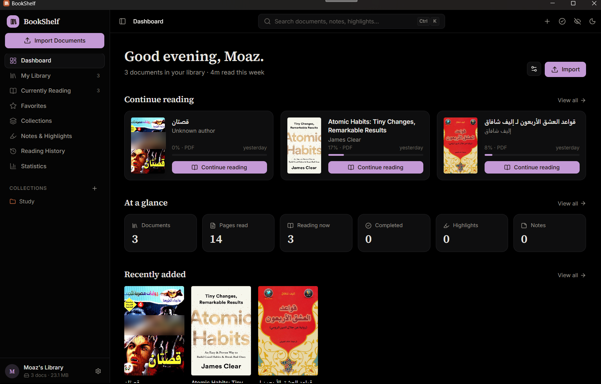
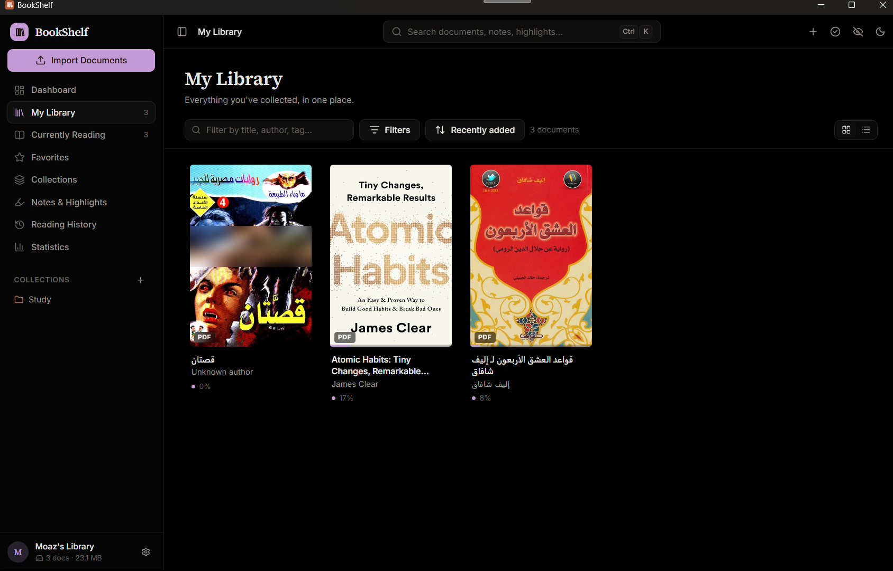
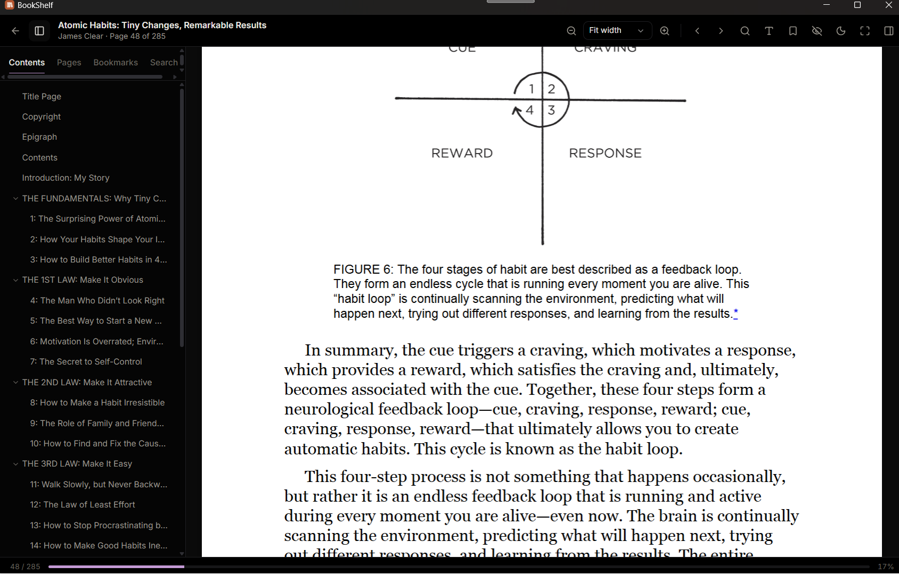
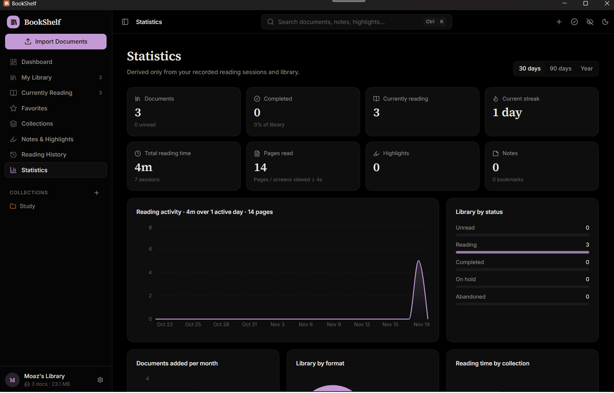

# BookShelf

A local-first desktop library for your PDFs, EPUBs, comics (CBZ), text and Markdown files. You can import, organise, read, highlight, bookmark and take notes, with no account and no cloud.

**[Download the latest release](https://github.com/Moazislam/Bookshelf/releases/latest)** for Windows, macOS, Linux or Android.

## Screenshots









## Features

- **Library**
  - Import by drag & drop, file picker or a whole folder, with progress and duplicate detection by content hash. Moved files are relinked automatically.
  - Metadata and covers are extracted automatically, and you can edit both.
  - Grid and list views (virtualised for thousands of documents), plus filters, sorting and bulk actions.
  - Statuses, favorites, nested collections and tags.
- **Reading**
  - **PDF:** pdf.js with range-streaming. Continuous or single-page view, zoom/fit, thumbnails, outline and text selection.
  - **EPUB:** epub.js with themes (light/sepia/dark), font, size, spacing, margins, alignment, and paginated or scrolled flow.
  - **TXT/MD:** a typographic reader.
  - **CBZ:** single page or spread, with fit modes.
  - Every format remembers its exact position.
- **Annotations:** highlights in 5 colours with comments.
  - Anchoring per format: PDF uses normalised page rects plus a text quote, EPUB uses a CFI, text uses offsets plus a quote.
  - Bookmarks, and a Markdown notes workspace with autosave, tags, highlight-linked notes and Markdown export.
- **Search:** SQLite FTS5 across titles, authors, tags, collections, notes, highlights and the full text of every document. Ctrl+K opens it.
- **OCR:** scanned PDFs and comics whose pages are only images become searchable and highlightable. Recognition runs fully on your device. English is built in; other languages download once (from jsDelivr) on first use and then work offline.
- **Insights:** a dashboard, reading history and statistics, all computed from measured reading sessions (active, visible time only).
- **Themes:** four light themes (Paper, Snow, Sepia, Sage) and four dark ones (Charcoal, Midnight, True black, Mocha), plus five accent colours. Light, Dark or System mode picks which theme is active, and book pages follow the theme when the reading theme is set to Auto.
- **Eye comfort:** a warm blue-light filter with adjustable warmth and screen dimming that covers the whole window, including book pages. Turn it on from the eye icon or with Ctrl+Shift+E, or schedule it (e.g. 21:00–07:00).
- **Data:** zip backup and restore, Markdown/JSON export, database maintenance, and configurable keyboard shortcuts.

Original files are never modified. On desktop, removing a document only deletes files when you explicitly ask, and even then they go to the Recycle Bin.

## Development

Prerequisites: Node 20+, pnpm, Rust (stable, MSVC on Windows), and WebView2 (preinstalled on Windows 11).

```bash
pnpm install
pnpm tauri dev        # run the desktop app with hot reload
```

```bash
pnpm typecheck        # TypeScript
cd src-tauri && cargo test   # Rust: migrations, import/dedupe, cascades, search, stats
```

## Build an installer

```bash
pnpm tauri build
```

This builds the installer for the system you're on:

| Platform | Output (in `src-tauri/target/release/bundle/`) |
| --- | --- |
| Windows | `nsis/BookShelf_<version>_x64-setup.exe` |
| macOS | `dmg/BookShelf_<version>_<arch>.dmg` and `macos/BookShelf.app` |
| Linux | `deb/*.deb`, `appimage/*.AppImage`, `rpm/*.rpm` |

Linux needs the WebKitGTK build dependencies first. On Debian/Ubuntu:
`sudo apt install libwebkit2gtk-4.1-dev libappindicator3-dev librsvg2-dev patchelf`.

### Automatic builds for every platform (GitHub Actions)

`.github/workflows/build.yml` runs on every push to `main` and on pull requests:

1. Type-checks the frontend and runs the Rust tests.
2. Builds installers on Windows, macOS (Apple Silicon and Intel) and Linux.
3. Uploads them as downloadable artifacts on the workflow run (Actions tab → run → *Artifacts*).

To publish a release, bump `version` in `src-tauri/tauri.conf.json` and `package.json`, then push a tag:

```bash
git tag v0.2.0
git push origin v0.2.0
```

The workflow creates a **draft** GitHub Release with every installer attached. Review it and click *Publish*.

### Unsigned builds

The installers are not code-signed, so the first launch shows a warning:

- **Windows:** SmartScreen → *More info* → *Run anyway*.
- **macOS:** right-click the app → *Open*. If macOS says the app is damaged, run `xattr -cr /Applications/BookShelf.app`.
- **Linux:** no warning. Make the AppImage executable with `chmod +x`.
- **Android:** download the `.apk` on your phone and open it. Android asks you to allow installs from your browser or file manager the first time.

## Android

The same app runs on Android, with a phone layout below 768 px wide. That layout has bottom tabs, a slide-in sidebar, and tap the left or right edge to turn EPUB and comic pages. Every phone keeps its own library; there is no sync.

On Android, imported files are copied into BookShelf's own storage, because apps can only keep reading files they own. The original file is never touched. Removing a book deletes that stored copy. *Show in folder*, folder import and drag & drop aren't available on phones.

### Set up Android development (one time)

1. Install [Android Studio](https://developer.android.com/studio). In **Settings → Languages & Frameworks → Android SDK**, install:
   - on the *SDK Platforms* tab, the latest Android version
   - on the *SDK Tools* tab, **Android SDK Build-Tools**, **NDK (Side by side)**, **Android SDK Command-line Tools** and **Android SDK Platform-Tools**
2. Point the tools at it. On Windows (PowerShell), then restart your terminal:
   ```powershell
   [Environment]::SetEnvironmentVariable("JAVA_HOME", "C:\Program Files\Android\Android Studio\jbr", "User")
   [Environment]::SetEnvironmentVariable("ANDROID_HOME", "$env:LOCALAPPDATA\Android\Sdk", "User")
   $ndk = Get-ChildItem "$env:LOCALAPPDATA\Android\Sdk\ndk" | Sort-Object Name | Select-Object -Last 1
   [Environment]::SetEnvironmentVariable("NDK_HOME", $ndk.FullName, "User")
   ```
3. Add the Rust targets for Android: `rustup target add aarch64-linux-android armv7-linux-androideabi i686-linux-android x86_64-linux-android`.
4. In Android Studio's **Device Manager**, create a virtual phone (for example a Pixel with a recent Android version). Or plug in your own phone with [USB debugging](https://developer.android.com/studio/debug/dev-options) turned on.
5. Generate the Android project once: `pnpm tauri android init`. This creates `src-tauri/gen/android`; commit it.

### Run and build

```bash
pnpm android:dev      # runs on the emulator or connected phone, with hot reload
pnpm android:build    # builds an APK in src-tauri/gen/android/app/build/outputs/apk/
```

In CI, the `android` job builds an APK for every push and attaches it to tagged releases. Without signing secrets it's a debug build, which installs fine for testing. For a release-signed APK, create a keystore once and **keep it safe**: you need the same key for every future update.

```bash
keytool -genkey -v -keystore bookshelf-release.jks -keyalg RSA -keysize 2048 -validity 10000 -alias bookshelf
```

Then add these repository secrets (Settings → Secrets and variables → Actions):
- `ANDROID_KEYSTORE_BASE64`: the keystore file, base64-encoded
- `ANDROID_KEYSTORE_PASSWORD`
- `ANDROID_KEY_ALIAS` (here, `bookshelf`)
- `ANDROID_KEY_PASSWORD`

## Architecture

```
src/                      React + TypeScript (Vite, Tailwind v4, Radix/shadcn-style UI, Zustand)
  components/             ui primitives, layout shell, library, notes, search
  features/reading/       reader store, session tracking, popovers, panels
    engines/              PdfEngine, EpubEngine, TextEngine, ComicEngine (one adapter per format)
  features/documents/     import pipeline + document actions
  pages/                  Dashboard, Library, Collections, Notes, History, Statistics, Settings, Reader
  services/api.ts         typed wrappers for every Rust command (the only place that calls invoke)
src-tauri/
  migrations/             numbered SQL migrations (PRAGMA user_version)
  src/database/           connection (WAL, foreign keys) + migration runner
  src/commands/           documents, collections/tags, annotations/notes, reading, search, stats, settings/backup
  src/document_processing/ EPUB/CBZ/text metadata + text extraction, hashing, cover thumbnails
  src/filesystem/         path validation, bookfile:// protocol (by document id, HTTP Range support)
```

The frontend has no direct filesystem access. Documents are served by id through the `bookfile://` protocol, and the capabilities only allow dialogs and window state. PDF metadata, covers and text are extracted by pdf.js in a background queue that resumes after restarts.

Data lives in the app data folder (`%APPDATA%\app.bookshelf.desktop`): `library.db` and `covers/`.

## License

[MIT](LICENSE)
